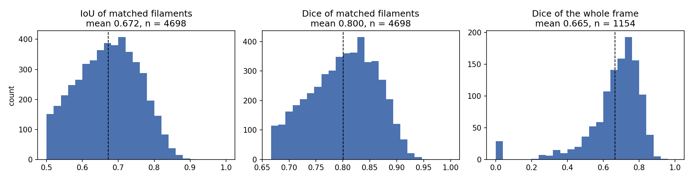

# Solar Filament Segmentation Challenge 2026

Instance segmentation of dark filaments in GONG H-alpha full-disk images
(2048x2048, 8-bit grayscale), for the
[Solar Filament Segmentation Challenge 2026](https://www.kaggle.com/competitions/filament-segmentation-2026).

Submissions are scored with **Panoptic Quality** at an IoU threshold of 0.5:

```
PQ = sum(IoU over matched pairs) / (|TP| + 0.5|FP| + 0.5|FN|)
```

Only pairs above IoU 0.5 are true positives, and the score is computed once per
*annotator-image*: an image annotated by three people is scored three times,
against three different ground truths.

## The final configuration

| | |
|---|---|
| model | U-Net with an HRNet-W32 encoder (ImageNet initialisation), 1024 x 1024 input, two channels: the frame and the frame after CLAHE |
| training | per-annotator targets, Dice + BCE, AdamW with cosine decay, 20 epochs, flips and quarter turns; one model per fold of a five-fold split grouped by frame |
| inference | each model averaged over the eight flips and quarter turns, then the five models averaged |
| post-processing | map upsampled to 2048, threshold 0.40, fragments rejoined across short collinear gaps, regions under 400 px and regions of mean probability under 0.65 dropped, predictions off the solar disk removed |
| score | pooled five-fold PQ **0.4127** (SQ 0.6716, RQ 0.6145); public leaderboard **0.36** |

Scoring one annotator's drawing against the other annotators of the same image
gives PQ 0.73 on fold 0, the practical ceiling for this task.

## Evaluation

Over the five folds, each fold model scoring the frames held out of its
training (707 frames, 1,154 annotator-images, 8,199 annotated filaments), with
the final post-processing:

| PQ | SQ | RQ | TP | FP | FN | Dice of matches | Dice per frame | split (1 to many) | fused (many to 1) |
|---|---|---|---|---|---|---|---|---|---|
| 0.4127 | 0.6716 | 0.6145 | 4,698 | 2,394 | 3,501 | 0.800 | 0.665 | 396 | 186 |

*Dice of matches* is the mean Dice of the filaments matched at IoU above 0.5;
*Dice per frame* compares all predicted pixels with all pixels one annotator
drew, averaged over annotator-images. Split counts annotated filaments covered
by more than one prediction, fused counts predictions covering more than one
annotated filament. Regenerate the numbers and figures in
[`docs/figures/`](docs/figures/) with `scripts/evaluation_report.py` from the
stored cross-validation maps.



## Reproducing the submission

The trained weights are in [`weights/`](weights/), one file per fold, in half
precision (72.8 MB each, under GitHub's 100 MB limit per file; they are restored
to single precision when loaded).

**Notebook.** [`notebooks/99_full_pipeline.ipynb`](notebooks/99_full_pipeline.ipynb)
runs the whole pipeline from those weights: it writes both submissions, checks
the weights on frames held out of training, and shows the predictions on the
images. On Kaggle, attach the competition data, turn on the internet and select
a GPU. On one T4 the whole notebook takes about 26 minutes: 6.1 s per test frame
for the 40 forward passes, and the fold-0 check gives PQ 0.4018 against the
recorded 0.4016.

**Command line.** With the dataset in place (see below):

```bash
uv run python scripts/predict_final.py --output outputs/final
```

Both write `submission.csv` (the final configuration) and
`submission_no_score_cut.csv` (the same without the cut on mean probability,
pooled PQ 0.4065, leaderboard 0.36), each checked for overlapping masks.

**Retraining.** The five fold models were trained on Kaggle with
[`notebooks/70_train_kaggle_cv_ensemble.ipynb`](notebooks/70_train_kaggle_cv_ensemble.ipynb)
from [`configs/phase6/e_unet_hrnet.yaml`](configs/phase6/e_unet_hrnet.yaml)
(about two hours per fold on a T4). Convert the resulting checkpoints with
`scripts/export_weights.py`.

## Requirements

- Python 3.12, the version Kaggle notebooks run
- [uv](https://docs.astral.sh/uv/)

`torch` is pinned to its **CPU build**: development and evaluation need no GPU,
and training runs on Kaggle, whose notebooks ship their own CUDA build. To
train elsewhere on a GPU, replace the two torch lines with a build matching
your CUDA version from [pytorch.org](https://pytorch.org/get-started/locally/).

## Setup

```bash
git clone git@github.com:KeiichiIto1978/Solar_Filament_Segmentation_Challenge_2026.git
cd Solar_Filament_Segmentation_Challenge_2026
uv sync
```

`uv sync` installs the pinned dependency set. For environments without uv,
`requirements.txt` holds the same versions:

```bash
pip install -r requirements.txt
```

Regenerate that file after changing a dependency:

```bash
uv run python scripts/export_requirements.py
```

### Running on Kaggle

Training runs on Kaggle notebooks (two T4 GPUs);
[`notebooks/10_train_kaggle.ipynb`](notebooks/10_train_kaggle.ipynb) is ready to
open there. Set the accelerator to **GPU T4 x2**, turn **Internet on**, and
attach the competition data. The first cell brings the code in:

```python
!git clone -q https://github.com/KeiichiIto1978/Solar_Filament_Segmentation_Challenge_2026.git /kaggle/working/repo
!pip install -q "segmentation-models-pytorch==0.5.0" "timm==1.0.29"
import sys; sys.path.insert(0, "/kaggle/working/repo/src")
```

The repository is cloned rather than installed from its URL because
`configs/paths.yaml` and the frozen splits sit beside the package rather than
inside it; a wheel would leave them behind and the run would be validated on a
different set of frames. The clone goes on `sys.path` rather than through pip:
this is a pure Python package, so the import works either way, and skipping pip
skips its interpreter-version check, which Kaggle's Python trips as it moves
ahead of the version this is locked against. Kaggle's preinstalled CUDA build
of torch is left alone, since replacing it costs minutes and risks a
mismatch with the driver.

Pushing to `main` and rerunning that cell is the whole update procedure, so the
notebook never holds a second copy of the code. Check out a commit hash instead
of `main` when a run has to be reproducible.

## Dataset

The competition data is distributed under CC BY-NC 4.0 and is **not** included
in this repository. Download it from the
[competition data page](https://www.kaggle.com/competitions/filament-segmentation-2026/data)
and unpack it so that the layout is:

```
MAGFiLO_1.0_Kaggle_2026/
├── train/
│   ├── train_images/                                  707 images
│   └── MAGFiLO_1.0_Annotations_kaggle2026_train.json  COCO format
└── test/
    └── test_images/                                   180 images
```

Place it at the repository root, or point the `MAGFILO_ROOT` environment
variable at your copy:

```bash
export MAGFILO_ROOT=/path/to/MAGFiLO_1.0_Kaggle_2026
```

Paths are configured in [`configs/paths.yaml`](configs/paths.yaml);
`MAGFILO_ROOT` takes precedence over the `dataset.root` entry, so no absolute
path ever enters the source tree.

The publicly released version of MAGFiLO is **not** used anywhere in this
repository. It overlaps the competition test set, and the organizers forbid it.

## Checks

```bash
uv run pytest
uv run ruff check .
uv run ruff format --check .
```

Tests that read the dataset are skipped when it is not present. The suite
includes the two checks the rest of the project depends on: the evaluator
returns exactly 1.0 when the ground truth is fed back as the prediction, and it
reproduces hand-computed scores on either side of the IoU 0.5 threshold.

## Usage

Regenerate the cross-validation split (already committed; the script refuses to
overwrite existing folds, because replacing them would silently invalidate
every score recorded against them):

```bash
uv run python scripts/make_splits.py
```

Write a submission of empty masks, as a format rehearsal:

```bash
uv run python scripts/make_dummy_submission.py --out submission.csv
```

Check any submission for overlapping masks before uploading it. Kaggle rejects
a submission whose masks share a pixel, and the rejected attempt still counts
against the five per day:

```bash
uv run python scripts/check_submission.py --csv submission.csv
```

Train the baseline (needs a GPU; use `--smoke` to check the wiring on a CPU in
about a minute):

```bash
uv run python scripts/train.py --config configs/phase1_unet.yaml
```

Score a checkpoint on its validation fold. This prints PQ with its breakdown
plus the counts of fused and split filaments, which is what says whether to
work on detection or on mask quality:

```bash
uv run python scripts/evaluate.py --checkpoint outputs/phase1_unet/best.pt --fold 0
```

Predict the test set. The overlap check runs before the script exits:

```bash
uv run python scripts/predict.py --checkpoint outputs/phase1_unet/best.pt --out submission.csv
```

Score predictions against ground truth in Python:

```python
from filament.data.coco import load_annotations
from filament.metrics.pq import compute_pq
from filament.submit.rle import masks_to_gt_df, read_submission

dataset = load_annotations()
gt = masks_to_gt_df(dataset, stems=["20140609195854Bh"])
result = compute_pq(gt, read_submission("submission.csv"))
print(result)  # PQ=... SQ=... RQ=... TP=... FP=... FN=...
```

## Submission format

A single CSV with two columns and one row per predicted filament:

```
filament_id,segmentation_rle
20150125172714Mh_1,PPYd1...
```

- `filament_id` is `<image id>_<running number>`, the image id without its
  extension; the number only makes rows unique.
- `segmentation_rle` is the *counts* field of a pycocotools compressed RLE on
  its own. The size is a constant 2048x2048 and is not written, and the value
  is never quoted.
- Masks of the same image must not overlap, not even by one pixel.

## Experiment records

One record per phase, in [`docs/experiments/`](docs/experiments/): what was
built, what it measured, what was learned, and what came next.

Scores are fold 0 PQ until Phase 7, pooled five-fold PQ from then on.

| Phase | Outcome |
|---|---|
| [0 — Evaluation foundation](docs/experiments/phase0-evaluation-foundation.md) | PQ measurable locally; human agreement puts the ceiling at PQ 0.73 |
| [1 — Semantic baseline](docs/experiments/phase1-semantic-baseline.md) | fold 0 PQ 0.3454, leaderboard 0.29 |
| [2 — Choosing the source of the masks](docs/experiments/phase2-mask-source.md) | U-Net kept; a filter bank reached PQ 0.16 at fifteen times the cost |
| [3 — Tuning the post-processing](docs/experiments/phase3-postprocessing.md) | fold 0 PQ 0.3756, from rejoining fragments and a larger minimum area |
| [4 — Training on the share of annotators](docs/experiments/phase4-vote-targets.md) | rejected |
| [5 — Charging for a filament predicted as two](docs/experiments/phase5-centreline-loss.md) | rejected |
| [6 — Instances and pixels](docs/experiments/phase6-instances-and-pixels.md) | nothing adopted; three of four encoders lose for lack of a half-resolution feature map |
| [6b — Target, resolution and encoder](docs/experiments/phase6b-target-resolution-encoder.md) | HRNet-W32 at 1024 adopted, fold 0 PQ 0.3815 |
| [7 — Five folds and an ensemble](docs/experiments/phase7-cross-validation-ensemble.md) | pooled PQ 0.3807; five-model ensemble, leaderboard 0.34 |
| [8 — Test-time augmentation](docs/experiments/phase8-tta-and-model-mix.md) | eight views adopted, 0.3998, leaderboard 0.35; mixing two model types not worth it |
| [9 — Post-processing for the eight-view maps](docs/experiments/phase9-postprocessing-for-tta.md) | 2048 and threshold 0.40 adopted, 0.4065, leaderboard 0.36 |
| [10 — False positives and a score cut](docs/experiments/phase10-false-positives-and-score-cut.md) | cut on mean probability 0.65 adopted, **0.4127**, leaderboard 0.36 |
| [11 — Judging each candidate from several features](docs/experiments/phase11-candidate-filter.md) | +0.0018, not adopted |
| [12 — Where the misses come from](docs/experiments/phase12-where-the-misses-come-from.md) | about 60% of misses are filaments the model does not see, or sees a third of |
| [13 — The annotators' spines as a second target](docs/experiments/phase13-spine-target.md) | +0.0021 on fold 0, not adopted |
| [14 — A larger network, a union target, growing into the faint ends](docs/experiments/phase14-weekend-screen.md) | nothing adopted; the Phase 10 configuration is final |

## Repository layout

```
configs/            paths.yaml, the frozen splits, training settings per phase
docs/experiments/   one record per phase
notebooks/          00_eda.ipynb, the Kaggle training notebooks, 99_full_pipeline.ipynb
scripts/            command line entry points
weights/            the five fold models of the final configuration
src/filament/
├── data/           COCO reading, splits, frames, solar disk, torch dataset
├── models/         the U-Net and its loss
├── training/       configuration and the training loop
├── postprocess/    probability map to non-overlapping instances
├── metrics/        Panoptic Quality, submission overlap check
├── submit/         RLE encoding, submission CSV
├── evaluation.py   inference, test-time augmentation and scoring
└── pipeline.py     the final configuration, from weights to submission
tests/
```

## License

[Apache-2.0](LICENSE).
